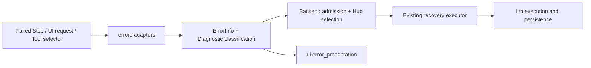

# Hub error contract and recovery policy

Hub transports failures as `ErrorInfo`. Classification, recovery authorization and localized presentation
are separate responsibilities. The application adapts llm's public diagnostics and selector contracts;
it does not change backend error codes, persistence, approvals, Tool receipts or retry ownership.

## Contract and classification

`errors/contracts.py` defines a frozen, detached envelope. The adapter copies source diagnostics once
at a failure boundary. Consumers must treat its nested diagnostic/source data as read-only.

| Field | Meaning |
| --- | --- |
| `code`, `message` | Original error identity/text; never replaced by a normalized UI label |
| `details`, `traceback`, `source` | Captured evidence and project/session/run/step/call identity. Local exceptions retain their traceback; stored errors retain only evidence the backend actually captured |
| `origin`, `operation`, `stage` | Reporting boundary and operation, not an assignment of blame |
| `category`, `reason` | Broad cause family and specific cause |
| `confidence`, `evidence` | Whether the classification follows an explicit code/status/type or a text inference, and which fields support it |
| `explanation`, `recovery` | Separate model explanation and observed recovery outcome; never inputs to evidence classification |

Broad categories are service/connectivity, access/security/policy, input/contract, resource limits,
execution, internal implementation and unknown. HTTP client/server status is evidence within this
classification, not the top-level responsibility hierarchy. For example, a provider-normalized context
failure retains `provider_invalid_request` while its classification is resource/context. An unsupported
option is contract/parameter. A generic missing-file exception stays unknown; it does not prove that
the model chose the wrong path.

The only classifier is llm's public `Diagnostic.classification`. Hub copies its category, reason,
confidence (`explicit`, `inferred`, `unknown`) and evidence without reclassifying HTTP statuses or
searching exception text. Unknown codes remain unknown even if they contain a familiar status or phrase.
The removed Hub classifier is not retained as a fallback. Local, explicitly identified Hub validation
may use a Hub-owned validation category. Specific UI guidance can describe known error codes or finish
reasons without changing classification or granting recovery permission.

Provider diagnostic `exceptions` is an outer-to-inner cause chain, not a series of retry attempts.
The adapter reads status and message from the same provider-bearing cause where available. Model
analysis and request content are never searched to invent a context-limit diagnosis. Display length
limits and terminal control-character filtering apply only in presentation, not to original evidence.

## Recovery authorization

Provider recovery eligibility and Run/RAG resumption are backend decisions. `errors/policy.py` only
selects an application action at an already-admitted Tool callback, using explicit effect/safety facts.
The removed Hub provider policy and independent attempt loop are not retained.

| Situation | Hub decision |
| --- | --- |
| Known rejected context, reducible data, no response/effects, budget available | Explain if enabled, validate the proposal, reduce the input copy, retry the same live completion |
| Unknown or unsupported provider request | Bounded explanation when enabled; a model proposal alone cannot authorize compaction/replay |
| Authentication, permission, connectivity, rate limit or outage | Leave provider transport retry to its existing owner; no second Hub retry budget |
| Tool retry selector invoked after backend safety/budget checks | Preserve safe transient retry or propose only declared argument corrections; backend revalidates and reauthorizes |
| Partial response, cancelled operation, exhausted budget/deadline or uncertain effects without trusted safety | Stop automatic recovery |
| Settings/input validation | Local feedback; no model call |

The Tool selector is a trusted backend callback: llm checks effects, retry safety, count and deadline
before invoking it. Hub records that admission explicitly rather than deriving permission from an
error category. `changeable` fields imply a backend-confirmed no-effect repair opportunity; they
do not permit changing Tool names, permissions or arbitrary keys. A new caller must not fabricate
these facts. Existing approvals and operation-key receipt checks still run after correction.

Provider recovery receives `CompletionRecovery` and returns `CompletionRepair` for backend-declared
editable bodies. Corrected and transient attempts share the original Provider policy budget and deadline.
Run resumption uses `resume_plan`, `resume` or explicitly allowed `restart` with `expected_revision`.
RAG uses `aresume_plan` and `arun_job` with the reviewed revision. A stale/blocked plan stops the action;
Hub does not force a fresh submission as a fallback. No Step/checkpoint presence heuristic grants restart.

Provider recovery scopes effects to the current rejected completion, never the entire Run. Previous
completed Tools stay completed and are not replayed. A model recommending `compact` for an unsupported
option is rejected. Analysis/summary/argument-repair calls share `execution/recovery_model.py`: bounded
JSON output, no Tools, no inherited SDK retries, and normal owning-Run Step/usage observation.

## Boundaries and UI

- `backend/observability/failures.py` selects the owning failed Step and returns the contract. It
  validates source identity, falls back to the same Run result diagnostic, and never reads old logs.
- RAG progress uses the current Job diagnostic only. Archived `failures` are history, not the current
  failure; a successful retry clears the error display. Checkpoint blockers use the same localized presenter.
- Provider recovery and Tool selection consume the same contract but have separate execution facts.
- `UIRequests` converts asynchronous request exceptions, including component management, before
  delivery. Success with `None`, a cancelled future, and failure are distinct results. Cancellation
  completes UI cleanup without an error alert or retry.
- Backend worker reports, settings partial-save/usage failures, request-deletion partial failures and
  automatic-title failures also carry `ErrorInfo`. Expected local settings validation is normalized
  at its UI boundary.
- `ui/error_presentation.py` owns notice text, language keys, literal detail/model-analysis rendering
  and display truncation. `ui/presentation.py` appends this projection to a failed assistant message
  without replacing partial output. Settings retain their existing status-line feedback and other
  requests retain their existing notifications.

Approval waiting, questions, pauses and cancellation continue through their existing state/event
paths, not error recovery. Local parser fallbacks and render placeholders are not promoted into
execution failures. The adapter/classifier/policy/presenter do not write logs: the subsystem owning
the actual operation continues to own diagnostic persistence, avoiding duplicate records. UI-only
errors are not automatically copied into new persistent logs.

## Adding a new failure

1. Preserve its original code and evidence at the closest boundary. Reuse `from_exception` or
   `from_diagnostic`; do not pass a localized string in place of an available structured error.
2. If a new backend classification is needed, add it at the backend contract boundary, separately from Hub.
   Hub keeps the unknown projection until that contract supports the evidence.
3. Add localized guidance separately. New categories do not implicitly acquire recovery actions.
4. Add a recovery rule only with explicit scope, safety evidence, bounds, approval ownership and
   integration tests showing completed effects are not repeated.

The tests in `tests/hub/test_error_contract.py` cover contract preservation, cause chains, unknown
errors, precedence, policy gates, model-inference separation and UI cancellation. Real Loop/Tool
integration tests cover the same decisions with mocked providers, including a misleading model
recommendation. No live corporate endpoint is needed for these tests.

## Validation (2026-10-17)

Linux Python 3.12.14, source snapshots on the WSL Linux filesystem:

- Focused contract, recovery, Tool, UI request and settings tests: 70 passed.
- Full Hub discovery: 484 tests, 475 passed; 9 private X11 clipboard tests skipped because
  Xvfb and xclip were unavailable. Reports: `tests/llm/reports/ish-provider-tz03sfuu/{focused,hub}.txt`.
- Full llm discovery: 1565 passed. Report: `tests/llm/reports/ish-provider-lfmm0z00/suite.txt`.
  The superseded Hub discovery launched by that older runner was stopped after llm completed;
  the final Hub result above uses the latest snapshot.
- All 281 Hub source/test Python files match the final Hub snapshot. All 175 llm Python files
  match the backend validation snapshot. `llm/` was not modified.
- Provider failures are simulated; the tests do not contact the corporate model endpoint.

## Backend contract integration validation (2026-10-18)

- Linux Python 3.12.14 on hash-recorded WSL Linux filesystem snapshots.
- Backend full discovery: 1635 passed (`tests/llm/reports/ish-provider-8e5ie53o/suite.txt`).
  The older Hub discovery scheduled by that runner was stopped after backend validation; the
  final Hub snapshot below supersedes it.
- Hub full discovery: 497 tests, 488 passed and 9 X11 clipboard tests skipped because Xvfb/xclip
  were unavailable (`tests/hub/reports/ish-hub-contract-e6y3pz81/hub.txt`).
- A final RAG concurrency guard rechecks the local observer after awaiting the backend resume plan.
  Its RAG/diagnostic follow-up suite passed all 23 tests
  (`tests/hub/reports/ish-hub-contract-d02tvdt5/focused.txt`). The backend still owns admission and effects.
- Hash verification covers all 285 Hub source/test Python files against the full snapshot plus the
  two RAG follow-up files, and all 298 backend source/test files against the backend snapshot.
  `llm/`, `tests/llm/` and `docs/llm/` were not modified by this integration.
- Simulated providers and local test endpoints cover context repair, unchanged Tool receipts,
  exhausted budgets, rejected proposals, stale revisions, pre-execution restart, request position,
  RAG chunk reuse and current-versus-archived failures. No live corporate model endpoint was contacted.
